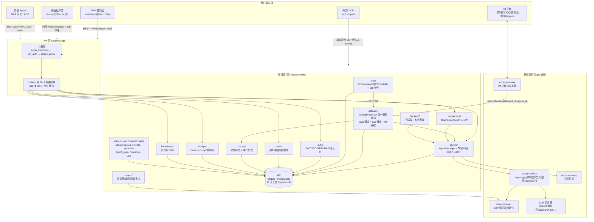
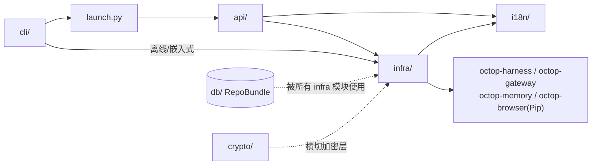

# Octop 代码说明书

> 生成日期:2026-11-25
> 代码版本:v1.0.3b7(commit `30f4aecd`)
> 仓库:https://github.com/wangsnail1985/Octop-origin.git(源自 TencentCloud/Octop)

---

## 目录

1. [项目概述](#1-项目概述)
2. [总体架构图](#2-总体架构图)
3. [顶层目录结构总览](#3-顶层目录结构总览)
4. [后端核心 `src/octop/`](#4-后端核心-src octop)
5. [Web 控制台前端 `dashboard/`](#5-web-控制台前端-dashboard)
6. [桌面客户端 `desktop/`](#6-桌面客户端-desktop)
7. [插件 `plugins/`](#7-插件-plugins)
8. [部署资产 `deploy/`](#8-部署资产-deploy)
9. [飞牛 NAS 安装包 `fnos/`](#9-飞牛-nas-安装包-fnos)
10. [脚本 `scripts/`](#10-脚本-scripts)
11. [测试 `tests/`](#11-测试-tests)
12. [文档 `docs/`](#12-文档-docs)
13. [工程配置(根目录文件、.github、.githooks 等)](#13-工程配置)
14. [横向依赖关系总结](#14-横向依赖关系总结)

---

## 1. 项目概述

**Octop** 是腾讯开源的、支持多用户多 Agent 的自托管 AI 助手平台(Python 3.12 + FastAPI + React 18)。

- **单进程架构**:一条 `octop run` 同时提供 Web 控制台、CLI、IM 通道(飞书/钉钉/QQ/微信/企业微信/Telegram)与定时任务,不依赖外部消息队列或中间件。
- **控制面数据库**:默认 SQLite(WAL),可选 PostgreSQL;数据存于 `~/.octop/`。
- **Agent 运行时**基于外部 pip 依赖 `octop-harness`(模型路由、工具、技能、对话 checkpoint),IM 协议桥接基于 `octop-gateway`,记忆基于 `octop-memory`,浏览器自动化基于 `octop-browser`。
- **扩展体系**:专家库(Expert)、Connector(OAuth + MCP)、插件(Tool/Skill/Hook/UI)、ACP 双向集成、实例桥(Bridge)。

---

## 2. 总体架构图



**一次对话的完整链路**(以 Web 控制台为例):

```
用户输入 → Dashboard WS(/api/agents/{id}/chat/ws)
        → api/routers/chat/ws(prepare_dashboard_turn 组装 InboundMessage)
        → gateway.GlobalProcessor(按 tenant_id 路由到 HarnessAgent)
        → agents.AgentManager.get_agent(注入 MCP/知识/技能/中间件)
        → octop-harness 流式执行(LLM + 工具调用,HITL 审批可暂停)
        → 流式 chunk → history(消息投影 + 轨迹)→ WebSocketHub 推回前端
        → 出站 push_text 同步推送到绑定的 IM 通道
```

---

## 3. 顶层目录结构总览

```
octop-origin/
├── src/octop/          # 后端核心(Python 3.12,FastAPI + 领域逻辑)
│   ├── api/            # HTTP/WS API 层
│   ├── cli/            # 命令行工具
│   ├── i18n/           # 国际化文案
│   ├── infra/          # 基础设施/领域逻辑层(最大的包)
│   ├── config.py       # 配置加载
│   └── launch.py       # 组合根(启动入口)
├── dashboard/          # Web 控制台前端(React 18 + TS + Vite + antd)
├── desktop/            # 桌面客户端(Electron 45 壳 + 绿色便携包)
├── plugins/            # 插件示例与市场占位
├── deploy/             # Docker / Helm / k8s 部署资产
├── fnos/               # 飞牛 NAS(FnOS)安装包(docker 版 + native 版)
├── scripts/            # 安装/构建/发布脚本
├── tests/              # 单元 / 集成 / live 三层测试
├── docs/               # 项目文档 + ADR
├── pyproject.toml      # Python 包元数据(入口 octop = octop.cli.main:cli)
├── Makefile            # 构建/开发/质量命令
└── .github/            # 12 个 CI/CD workflow
```

| 目录 | 语言/技术 | 规模 | 职责一句话 |
|---|---|---|---|
| `src/octop` | Python 3.12 + FastAPI | 694 个 .py | 服务端:API、CLI、领域运行时 |
| `dashboard` | React 18 + TS + Vite | — | Web 控制台 SPA,构建产物输出到 `src/octop/dashboard` 由后端同源托管 |
| `desktop` | Electron 45 + TS | — | 桌面壳:拉起内嵌 Python sidecar + 托盘/更新/WS 中继 |
| `plugins` | Python / JS | 6 个插件 | 插件样例与市场占位 |
| `deploy` | Docker/Helm | — | 镜像构建、Helm chart、Compose 五件套 |
| `fnos` | Shell + fnpack | 4 种 .fpk | 飞牛 NAS 安装包(docker 版/native 版) |
| `scripts` | Shell/PowerShell | — | 一键安装、wheel 构建、FPK 打包、发布上传 |
| `tests` | pytest | 519 单元 + 85 集成 + 6 live | 三层测试体系 |
| `docs` | Markdown | 3 篇 ADR + 30+ 主题文档 | 架构决策与使用文档 |

---

## 4. 后端核心 `src/octop/`

### 4.1 包顶层文件

| 模块 | 功能 | 输入 | 输出 | 关联模块 |
|---|---|---|---|---|
| `__init__.py` | 版本号(1.0.3b7);import 时打 httpx NO_PROXY CIDR 补丁 | — | 版本元信息 | 全局 |
| `__main__.py` | `python -m octop` 入口 | 命令行 | 转发到 `octop.cli.main:cli` | cli |
| `config.py` | 配置加载(`~/.octop/config.json`、环境变量) | 配置文件/env | `Config` 对象 | infra 全部 |
| `launch.py` | **组合根**:启动 `OctopServer` → 构建 FastAPI app → 启动 uvicorn(支持 HTTPS 双端口 + ACME 伴生应用) | CLI `run` 命令 | 运行中的服务进程 | api、infra/server |

### 4.2 `src/octop/api/` — FastAPI HTTP 层

**整体职责**:将 `infra/server.py` 的 `OctopServer`(领域运行时)暴露为 REST/WebSocket API;负责 JWT 鉴权、setup 锁定、Bridge 隧道代理、路由挂载、异常→i18n 错误信封转换、Dashboard SPA 静态托管。自身不含业务逻辑,全部委托 `infra` 模块。

| 模块 | 功能 | 输入 | 输出 | 关联模块 |
|---|---|---|---|---|
| `app.py` | 应用工厂 `build_app(server)`:安装中间件、异常处理器、挂载约 60 个路由、SPA catch-all 回退 | OctopServer 实例 | FastAPI 应用 | middleware、routers、infra.errors |
| `deps.py` | 鉴权依赖闸门:`current_user`、`require_permission(key)`、`require_admin()`、JWT 豁免清单、token 滑动续期 | HTTP 请求头/查询参数 | `User` 对象 / 401/403 | infra.auth.tokens、infra.users |
| `openapi_meta.py` | OpenAPI 描述与标签元数据(Scalar 文档用) | — | 文档元数据 | api/docs |
| `bridge_peer.py` | ASGI 接线垫片:把 bridge 隧道接入 app(infra 不反向依赖 api 的隔离层) | ASGI app | 接线后的 app | infra.bridge |
| `middleware/jwt_auth.py` | 对 `/api/*` 强制 JWT,结果缓存到 `request.state.octop_user`;到期前 1/3 响应头附带新 token | 请求 | 放行/401 | api.deps |
| `middleware/setup_lockdown.py` | 无任何用户时,除 setup/health 外全部返回 503 `setup_required` | 请求 | 503 | server.user_manager |
| `middleware/bridge_proxy.py` | 把 `bridge:{connection_id}:{agent_id}` 形态的请求解析为隧道目标转发到远端 peer | 请求 | 隧道转发 | infra.bridge.ids |

**`api/common/` — 路由共享助手(14 个模块)**

| 模块 | 功能 |
|---|---|
| `agent.py` | Agent 归属/可见性断言(`assert_agent_access`、`require_agent_row` 等) |
| `agent_runtime.py` | Pydantic 模型 `AgentRuntimeFields`(每 agent 运行时/模型设置字段) |
| `agent_workspace.py` | 解析 agent 工作目录 |
| `attachments.py` | 聊天附件写入封装(`InboundFile`) |
| `client_ip.py` | 安全解析客户端 IP(仅信任 loopback 的 XFF,防伪造) |
| `content_disposition.py` | RFC 5987 中文文件名下载头构造 |
| `memory_client.py` | 按 agent 的 `octop_memory` 实例 LRU 缓存与 RPC 调用 |
| `public_base.py` | 解析对外可见 origin |
| `sso_cookie.py` | OIDC/OAuth 共享 SSO state cookie |
| `upload_limit.py` | 流式读取上传体并截断(防超大文件进内存) |
| `usage_xlsx.py` | openpyxl 生成 token 用量本地化 Excel 报表 |
| `validators.py` | 跨路由请求校验(后端目录限定、MCP/技能白名单) |
| `workspace.py` | 工作区粘合(对接 `octop_harness` 的 BackendWorkspace) |

**`api/routers/` — 路由模块(约 80 个文件、612 条路由,前缀 `/api`)**

| 分组 | 路由文件 | 功能 |
|---|---|---|
| 认证与账号 | `auth.py`、`auth_mfa.py`、`auth_device.py`、`auth_oidc.py`、`auth_oauth.py`、`auth_ldap.py`、`invites.py`、`users.py`、`user_roles.py`、`user_groups.py`、`preferences.py` | 登录/登出、TOTP/WebAuthn MFA、桌面设备 token、OIDC/OAuth/LDAP SSO、邀请码、用户/角色/组管理、偏好 |
| Setup 与元数据 | `setup.py`、`health.py`、`i18n.py`、`slash.py`、`mbti.py`、`experts.py`、`teams.py`、`subagents.py`、`managed.py` | 首启向导(含数据库延迟绑定)、存活探针、i18n 标签、斜杠命令目录、MBTI 人格测试、专家目录、团队 |
| Agent 核心 | `agents.py`、`agent_tools.py`、`agent_mcp.py`、`acp.py`、`agent_files.py`、`channels.py`、`cron.py` | Agent CRUD/启停/重载、工具开关、每 agent MCP、ACP runner、IM 渠道 CRUD + 扫码绑定、定时任务 CRUD |
| 对话(chat/ 子包) | `chat/ws.py`、`chat/routes.py`、`chat/history.py`、`chat/trajectory.py`、`chat/notify_ws.py`、`uploads.py`、`text_assist.py` | **对话主通道 WS**、欢迎卡片、HITL 恢复 SSE、线程 CRUD 与历史、轨迹查询/导出/live SSE、全局通知 WS、附件上传、文本润色 |
| Bridge/云/连接器 | `bridge.py`、`connectors.py`、`cloud.py`、`internal_mcp.py` | 实例桥连接管理与 WS 隧道、Connector 目录/OAuth callback、腾讯云 CVM、免 JWT 内部 MCP 注册 |
| 知识/记忆/搜索 | `knowledge_bases.py`、`memory.py`、`memory_portable.py`、`memory_storage.py`、`search.py` | 知识库 CRUD/索引选项、记忆原子/情景查询、记忆打包迁移、存储后端配置、搜索 |
| 模型/供应商/语音 | `providers.py`、`ollama_models.py`、`onnx_models.py`、`voice.py`、`media_generation.py` | 模型供应商管理/OAuth/探测、Ollama 与本地 ONNX 模型下载、STT/TTS/实时语音、媒体生成 |
| 管理后台 | `admin.py`、`app_config.py`、`backup.py`、`observability.py`、`tls.py`、`security.py`、`storage_backends.py`、`decision.py`、`settings.py`、`envs.py`、`usage.py` | 概览/审计/指标、原始配置、备份恢复、Langfuse、TLS 签发、工具防护、存储后端浏览、环境变量、用量导出 Excel |
| 系统运维 | `update.py`、`filesystem.py`、`workspace.py`、`terminal.py`、`browser/`、`desktop/`、`mobile/`、`plugins.py` | 自升级、服务器目录浏览、Agent 工作区文件管理、Web 终端 WS、浏览器 AI+(会话/录制回放/屏幕流)、远程桌面、远程 Android、插件管理 |

**输入/输出特征**:所有路由统一模式 —— `Depends(get_server)` 取 `OctopServer`,鉴权依赖拿到 `User`,然后调用 `server.app_runtime.*`(agent_registry、gateway、bridge_manager)或 `server.services.*`(各 Repo)。输出为 JSON 响应、SSE 流或 WebSocket 帧。

### 4.3 `src/octop/cli/` — Click 命令行

**整体职责**:`octop` 可执行文件(入口 `cli/main.py:cli`),24 个命令,覆盖安装引导、前台运行、用户/agent/渠道/定时任务管理、聊天 REPL。两条执行路径:**离线直连**(直接打开 `~/.octop` 的 SQLite)与**在线协调**(让运行中的 server 执行)。

| 模块 | 功能 | 输入 | 输出 | 关联模块 |
|---|---|---|---|---|
| `main.py` | `_LazyCLI` 按需 import 加载命令;`--user/--agent/--json` 根选项;强制 UTF-8 stdio | 命令行参数/env | 子命令分发 | registry |
| `registry.py` | 24 个命令的注册表(模块名、属性、帮助文案) | — | 命令表 | commands/* |
| `commands/run.py` | **服务器启动入口**:前台跑服务,host/port 优先级 CLI > env > config.json;调 `launch.run_foreground_blocking` | CLI 参数 | 运行中服务 | launch、api |
| `commands/init.py` | 引导安装:`~/.octop` 目录、DB 迁移、首个 admin | env `OCTOP_ADMIN_*`/交互 | 目录 + DB + 管理员 | infra.db、infra.users |
| `commands/service.py` | systemd/launchd 服务 start/stop/restart/status | CLI 参数 | 服务状态 | infra.setup.service |
| `commands/user.py` | create/list/passwd/reset-mfa/role/disable/delete | CLI 参数 | DB 写入(本地直连) | cli/support/db |
| `commands/agent.py` | create/from-expert/list/use/start/stop/reload/delete | CLI 参数 | DB + 嵌入式运行时 | infra.agents |
| `commands/chats.py` | 会话管理 + **交互式 REPL** | 键盘输入 | 流式终端渲染 | cli/repl |
| `commands/channel.py` | IM 渠道管理 + 钉钉/企微/微信扫码 + 飞书机器人代建 | CLI 参数 | DB + 二维码 | infra.gateway |
| `commands/cron.py` / `provider.py` / `models.py` / `skills.py` / `admin.py` / `backup.py` / `bridge.py` / `plugin.py` / `cloud.py` / `migrate.py` / `update.py` 等 | 定时任务 / 模型供应商 / Ollama / 技能开关 / 管理员 / 备份 / 实例桥 / 插件 / 腾讯云 / OpenClaw·Hermes 迁移 / 自升级 | CLI 参数 | 各自领域操作 | 对应 infra 模块 |
| `commands/acp.py` | 把 Octop agent 作为 ACP stdio server 运行 | stdio JSON-RPC | ACP 响应 | octop-harness |
| `cli/repl/` | REPL 支撑层:`session.py`(会话状态)、`runtime.py`(`CliChatSession` — 经 gateway.cli_hub 收流)、`embedded_session.py`(按引用计数共享嵌入式 OctopServer,不接管 channels/cron)、`render.py`(Rich 渲染)、`toolbar.py`(prompt_toolkit 底栏) | 用户输入 | 流式 Markdown 终端渲染 | infra.gateway.cli |
| `cli/support/` | 共享内部件:`db.py`(离线 DB 访问)、`embedded_ops.py` / `offline_ops.py`、`ctx.py`(根选项解析)、`acting.py`、`state.py`、`errors.py`、`prompts.py`、`qr.py`、`feishu_creator.py`、`skills.py` | — | — | infra.db、infra.server |

### 4.4 `src/octop/i18n/` — 国际化

**整体职责**:集中式 i18n。嵌套 JSON 文案包(en/zh)+ 点路径查找 + 按命名空间组织的类型化辅助函数。默认 locale 为 `zh`,缺失键回退 en。纯数据 + 查找,无 gettext。

| 模块 | 功能 | 输入 | 输出 | 关联模块 |
|---|---|---|---|---|
| `loader.py` | `importlib.resources` 加载 en.json/zh.json(lru_cache);`lookup` 点路径查找;`tr(key, locale, **kwargs)` 插值 | 键名 + locale | 本地化字符串 | — |
| `en.json` / `zh.json` | 30 个顶层命名空间(agent_errors/agents/channel/connector/cron/errors/knowledge/skills/teams/tls/tools/voice…) | — | 文案数据 | domains/* |
| `domains/*.py` | 类型化辅助:`errors.py`(OctopError 信封本地化)、`stream.py`(聊天/IM 流式错误分类与引导文案)、`tools.py`(内置工具显示名 + HITL 工具目录)、`slash.py`(斜杠命令标签)、`skills.py`、`tls.py`、`voice.py`、`agents.py` 等 | 错误码/键名 | 本地化文案 | api 异常处理器、gateway、usage_xlsx |
| `api/routers/i18n.py`(消费方) | `GET /api/i18n/tools|skills` 把工具/技能标签暴露给前端 | HTTP | JSON 标签 | dashboard |

### 4.5 `src/octop/infra/` — 基础设施/领域逻辑层

**装配根** `infra/server.py`:`OctopServer.boot()` 按依赖顺序装配 `AppRuntime` 单例:

```
open_database → SharedServices(RepoBundle,38 个仓储)
  → AgentManager → TrajectoryService → Gateway(GlobalProcessor)
  → CronDeliveryService → CronManager → ProactiveCareScheduler → BridgeManager
```

> 注:进程内消息路由器是 `gateway/process/processor.py` 的 **GlobalProcessor**;`control/` 是"宿主机控制面"(远程桌面/浏览器/手机),不是事件总线。

#### 4.5.1 `infra/agents/` — Agent 运行时管理(最大子包,109 个 .py)

| 模块 | 功能 | 输入 | 输出 | 关联模块 |
|---|---|---|---|---|
| `manager.py` | 进程级单例 `AgentManager`:管理全部 `octop_harness.HarnessAgent` 的创建/启停/删除、模型 provider 热同步 | API 路由、GlobalProcessor | HarnessAgent 实例、`agents` 表、workspace 文件 | db、providers、experts、plugins |
| `managed.py` | "managed" 类 expert(ACP runner 以普通 expert 形式寻址) | API | workspace 种子 | acp、experts |
| `conversation_mode.py` | 会话模式(plan/chat 等)切换 | 消息 | 模式状态 | gateway |
| `turn_resources.py` | 每轮知识与 MCP 资源解析(`attach_turn_knowledge`、`resolve_turn_mcp`) | turn 上下文 | 注入的 MCP/knowledge | knowledge、connectors |
| `experts/catalog.py` | 专家模板发现:`ExpertCatalog`(启动时扫描 `experts/library/`),expert = `manifest.json` + 磁盘文件;`seed_expert_directory` 写入 agent workspace | workspace 目录 | 专家目录 + workspace 种子 | setup、market |
| `experts/library/` | 内置专家库(default、ops-engineer、tencent-cvm-ops 等) | — | 模板文件 | catalog |
| `experts/default_agent.py` | 为新用户引导首个 expert(agent_id=main) | 用户创建事件 | 首个 agent | users、market_creation |
| `experts/publish.py` / `snapshot_store.py` / `published_creation.py` | 发布 agent workspace 为可安装的 published-expert 快照;快照存控制面 `control_files` 表 | workspace | 快照/发布包 | db、market |
| `experts/market_creation.py` / `skillhub_market.py` | 从门户/SkillHub 市场一键创建 agent(skillset 归一化为 manifest + SOUL.md + skills/) | 市场 HTTP | 新 agent | market、skills |
| `providers/` | 模型 Provider 层:`harness_factory.sync_providers_to_harness`(热同步)、`store.py`(ProviderStore)、`health.py`(模型健康)、`presets.py`、`probe.py`(连通性探测)、`codex_oauth.py`、`onnx_*`(本地 ONNX) | DB providers 表 | harness provider 工厂 | harness、api/providers 路由 |
| `memory/` | 记忆存储:`backend.py`(解析 memory 后端:SQLite 文件或复用 PG DSN)、`slim.py`(MemorySlimCoordinator 瘦身)、`thread_cleanup.py`(删线程时清理记忆与 checkpoint) | agent 配置 | octop-memory 后端实例 | octop-memory、db |
| `acp/` | 宿主侧 ACP 接线:`turn.py` 为托管 turn 附加回环 MCP(knowledge/agents/files/cron/memory/plugins 五个内部 MCP server);`permissions.py` 权限队列、`delegation.py` 委派 | ACP runner | 回环 MCP spec | knowledge、cron、files |
| `middleware/` | harness 中间件:`model_failover.py`(模型故障转移)、`token_quota.py`(配额)、`team_dispatch.py`(团队派发)、`browser_profile.py`、`reasoning.py` 等 | harness 链 | 中间件行为 | control/browser、providers |
| `security/` | HITL 会话策略、安全设置、工具防护规则存储 | API | 策略行 | gateway/hitl |
| `teams/` | `TeamManager` 团队房间:协调者调度多位专家协作 | 消息 | 多 agent 协作会话 | gateway、harness |
| `settings/` | 各类设置存储(ACP、compaction、decision、langfuse、runtime_limits、profile) | API | 设置行 | db |
| `workspace/` | workspace 目录布局(`dir.py`)与执行环境(`execute_env.py`) | agent 配置 | 目录句柄 | backend |
| `plugins/manager.py` | `PluginManager`(1137 行):插件安装(ZIP 安全校验:≤100MB/≤2000 entries/解压≤64MiB/压缩比防护)、装载、技能同步到 workspace、UI 文件解析、工具名拼音化 | ZIP/市场/本地目录 | 已装载插件 | octop-harness PluginRegistry、dashboard UI |

#### 4.5.2 `infra/gateway/` — 消息入口(IM + Dashboard + CLI)

| 模块 | 功能 | 输入 | 输出 | 关联模块 |
|---|---|---|---|---|
| `gateway.py` | `Gateway`:通道生命周期(从 DB 注册 feishu/dingtalk/wecom/qq/weixin/telegram 通道 + reconcile + 通道租约)、出站推送 `push_text/push_content` | channels 表、IM 平台回调 | 通道实例、出站消息 | octop-gateway(外部包)、db |
| `process/processor.py` | **GlobalProcessor(运行时路由核心)**:按 `InboundMessage.tenant_id`(=agent ULID)路由到 HarnessAgent;驱动 harness 流;HITL IM 审批中继;团队房间;轨迹观察;自动线程标题 | InboundMessage | 流式 MessageEvent | agents、history、teams |
| `process/harness_request.py` | 组装 harness 流请求与多模态内容(图片/文件 → ContentPart) | InboundMessage | harness 请求 | octop-harness |
| `process/agent_resolve.py` | 每 agent workspace 句柄解析 | agent_id | workspace/media backend | agents、backend |
| `process/response_mode.py` | 通道响应模式(stream/poll),微信流式前导抑制包装 | 通道配置 | 处理器包装 | 通道 |
| `process/usage_record.py` | `UsageTracker` 每轮 token 用量记录 | 流事件 | `usage_log` 表 | db |
| `channels/qr_bind.py` | 企微/QQ/微信扫码绑定(直连官方接口)、钉钉 Device Flow 注册 | 扫码轮询 | 绑定凭据 | api/channels |
| `channels/telegram_bridge.py` | Telegram 桥(宿主拥有按钮/回调校验) | Telegram API | 通道行为 | octop-gateway |
| `bot_creators/` | 飞书/元宝机器人代建(子进程) | 配置 | 机器人应用 | cli/channel |
| `ws/ws_hub.py` + `ws_channel.py` | Dashboard WebSocket:`WebSocketHub`(连接注册表、按 thread 订阅)+ `WebSocketChannel`(dashboard 虚拟通道) | 前端 WS | 流式帧 | api/chat |
| `cli/cli_channel.py` | 内置 CLI 通道:`CliChannel`/`CliHub`(CLI REPL 的服务端侧) | CliChatSession | 流式 chunk | cli/repl |
| `hitl/` | 人在环:`HitlChannelCoordinator`(暂停/恢复)、`phrases.py`(IM 里回复"同意"即审批)、`store.py`(pending 存储) | 用户审批 | turn 续跑 | agents/security、IM 通道 |
| `steer/coordinator.py` | `SteerCoordinator`:mid-turn 转向队列(对话中途插话) | WS steer 帧 | 注入 turn | api/chat/ws |
| `slash/` | 斜杠命令系统:`catalog.py`(命令目录)、`dispatcher.py`、`handlers/`(hitl/memory/platform/session) | `/command` 输入 | 命令动作 | i18n/slash |
| `media/` | 入站/出站媒体:`inbound_store.py`(附件写入 `inbound/`)、`attachment_hints.py`(vision 提示)、`tool_media.py`(工具结果富化) | 上传文件/消息 | 多模态内容 | api/uploads |
| `threads.py` | `ThreadRegistry`:session_key → thread_id 绑定(dashboard/cli/mcp 虚拟通道) | 消息 | thread 绑定 | db threads/sessions |
| `history_backfill.py` | 旧 checkpoint 历史投影的单工人补录队列 | 旧归档 | thread_messages | history |

#### 4.5.3 `infra/history/` — 对话历史与轨迹

| 模块 | 功能 | 输入 | 输出 | 关联模块 |
|---|---|---|---|---|
| `projection.py` | `TurnHistoryTracker`:从 harness 流捕获当前轮,写轻量消息投影(UI 历史用) | 流 chunk | `thread_messages` 表 | db、gateway |
| `trajectory/service.py` | `TrajectoryService`:编排 project → store → live 发布(0.05s 节流、指标聚合 1s 缓存) | 流 chunk | 轨迹事件 + 实时推送 | store、live |
| `trajectory/types.py` | `TrajectoryEvent`(kind: user/assistant/tool/context/compacted/system) | — | 事件类型 | — |
| `trajectory/store.py` / `live.py` / `metrics.py` | 持久化(TrajectoryEventRepo)/进程内 pub/sub 实时推送/token 与时长指标 | 事件 | `trajectory_events` 表、WS | db、dashboard 轨迹页 |
| `retire_v2.py` | 一次性迁移:旧版 v2 历史归档导入新表 | 旧 SQLite 归档 | 新表数据 | db |

#### 4.5.4 `infra/cron/` — 定时任务(APScheduler)

| 模块 | 功能 | 输入 | 输出 | 关联模块 |
|---|---|---|---|---|
| `manager.py` | `CronManager` 进程级单例:AsyncIOScheduler + 全部 CronJob;从 DB 对账(`reconcile_user_jobs` 周期循环);`schedule_system_job` 供 TLS 续期、自动备份注册系统任务;邮件监听 | cron_jobs 表、API | 调度触发 | db、delivery |
| `job.py` | `CronJob`:执行前经 `CronJobRepo.claim_run` **抢 DB 租约**(多实例防重复),续租执行 | 触发 | 投递 + 审计 | db/lease |
| `trigger.py` | 触发字符串 → APScheduler trigger(cron/interval/date + 邮件事件源);misfire 宽限(RECURRING 60s / ONE_SHOT 24h) | 触发配置 | trigger 对象 | APScheduler |
| `delivery.py` | `CronDeliveryService`:投递编排,与通道传输解耦 —— task_type=text 直接落消息;task_type=agent 构造 harness 请求走完整 agent turn | CronDeliveryCommand | 通道推送/harness turn | gateway、agents |
| `session_target.py` | session_key 指向通道或历史线程(`thread:<id>` 前缀) | 任务配置 | 目标解析 | threads |
| `tools.py` | 给 agent 的 cronjob 工具集(增删改查/run_now 六个 StructuredTool) | agent 调用 | cron 管理 | agents |

#### 4.5.5 `infra/db/` — 数据库(连接池/迁移/仓库/DI)

| 模块 | 功能 | 输入 | 输出 | 关联模块 |
|---|---|---|---|---|
| `pool.py` | 双方言连接池:`SqlitePool`(单写连接 + WAL)/ `PostgresPool`(psycopg 池,`?` 占位符自动转 `%s`),统一暴露 sqlite 风格 API | 配置 | 连接/事务上下文 | 全部 |
| `factory.py` | `open_database(config, paths)` 按配置返回 SQLite 或 PG 池;`should_defer_control_plane_db`(setup 向导前延迟绑定) | Config | Pool | config、setup |
| `migrate.py` | 启动时版本化迁移:扫描 `migrations/NNN_*.sql`(25 对,`NNN_name.sql` + `.pg.sql` 成对) | 迁移文件 | 表结构 | migrations/ |
| `services.py` | `RepoBundle`(38 个 repo 的冻结容器)+ `SharedServices`(懒加载 DI);provider/backend/voice 经 `crypto.Sealed*Repo` 透明加密包装 | Pool | 各 Repo | crypto |
| `repos/` | 各表仓储:users、agents、channels、sessions、threads、thread_messages、trajectory_events、cron(含租约 claim)、settings、secrets、sso、skill_packages、published_experts 等 | 行数据 | 持久化 | 对应领域模块 |
| `lease.py` | 跨实例租约 SQL 原语(多副本防重复) | SQL | 租约行 | cron、gateway 通道租约 |
| `file_store.py` | PG 大文件存储(技能包/知识库原文) | bytes | 文件表 | skills、knowledge |
| `probe.py` / `rebind.py` | 用户数探测 / 控制面 DB 热重绑(向导换库时整体替换 repos 指针) | 连接 | 探测结果 | setup |

#### 4.5.6 `infra/auth/` — 认证

| 模块 | 功能 | 输入 | 输出 | 关联模块 |
|---|---|---|---|---|
| `tokens.py` | JWT 签发/校验(`sign_token` 必须带 purpose: access/mfa/reauth);HTTP 与 Bridge 共用 | 凭据 | JWT | api.deps、bridge |
| `captcha/` | 登录验证码:滑块/表单/reCAPTCHA v3/Geetest v4/腾讯云五种 provider + 校验 + 限流 | 前端验证 | 校验结果 | api/auth |
| `sso/` | OIDC 与可插拔 OAuth SSO 编排(`SsoService`);providers 返回 oidc/feishu/dingtalk/wecom 四种适配器;PKCE、discovery 缓存、secret 加解密 | OAuth 回调 | 用户身份/JWT | users、crypto |
| `mfa/` | MFA 编排:TOTP、WebAuthn、恢复码、重认证、管理员重置 | 验证码 | 挑战/验证结果 | db |
| `ldap/` | LDAP 目录认证(`LdapClient` + 绑定限流) | 账密 | LdapIdentity | users |

#### 4.5.7 `infra/users/` — 用户生命周期与权限

| 模块 | 功能 | 输入 | 输出 | 关联模块 |
|---|---|---|---|---|
| `manager.py` | `UserManager` 单例:创建/认证(Argon2id)/SSO 建号/改密/角色/策略 | 注册/登录请求 | `User` 对象 | db、auth |
| `permissions.py` | 模块级权限目录与判定(admin 全通过;读与聊天不设门) | 用户 | 权限集合 | api.deps |
| `groups.py` | 用户组资源可见性(专家/模型对组成员可见性收窄) | 用户 | 可见性判定 | experts、providers |
| `resource_policy.py` | 每用户策略:工作区根、token 配额、允许的后端类型、最大 Agent 数 | 策略 JSON | 限制值 | backend |
| `invites.py` | 一次性邀请码(生成/校验/兑换)+ 限流 | 邀请码 | 注册资格 | api/invites |
| `password.py` / `identity.py` / `preferences.py` | Argon2id 哈希与密码策略 / Role 与 User 原语 / 每用户 JSON 偏好 | — | — | — |

#### 4.5.8 `infra/bridge/` — Octop↔Octop 实例桥

| 模块 | 功能 | 输入 | 输出 | 关联模块 |
|---|---|---|---|---|
| `manager.py` | `BridgeManager`(约 2700 行):连接生命周期、活动会话、HTTP 隧道(`tunnel_http`)、turn 中继、远端 agent 列举 | API + 对端 WS | 远端实例调用、`bridge_connections` 表 | db、auth/tokens |
| `transport.py` | 进程内 Bridge WebSocket 会话(复用 HTTP 隧道 + turn 帧,body 上限 8MB) | WS 帧 | 隧道流量 | — |
| `crypto.py` | 载荷加解密 | payload | 密文/明文 | crypto |
| `peer_turn.py` | 对端 turn 执行器(PeerTurnRunner/PeerBrowserRunner) | turn 请求 | 远端执行 | gateway |
| `http_tunnel.py` | 本地 HTTP 执行(远端请求落到本地) | HTTP 请求 | 响应 | api |
| `ids.py` | bridge agent ID 编解码(`bridge:` 前缀,远端 agent 参与本地路由) | ID | 解析结果 | gateway、api |

#### 4.5.9 `infra/control/` — 宿主机控制面(浏览器/桌面/手机)

| 模块 | 功能 | 输入 | 输出 | 关联模块 |
|---|---|---|---|---|
| `browser/` | 浏览器环境安装/卸载、Chromium 运行时保障、profile 准备、marker 文件启用确认 | 安装命令 | 浏览器运行环境 | octop-browser、agents/middleware |
| `desktop/` | 远程桌面:`ScreenCapture`(截屏)、`InputInjector`(pynput + xdotool 注入)、会话管理(每用户单流)、Linux 虚拟显示安装脚本 | API + harness 工具 | 截屏 WS 流、键鼠注入 | api/desktop 路由 |
| `mobile/` | Android 远程控制:adb、`MobileAgentControl` 单例、`build_mobile_tools`(给 agent 的手机控制工具)、H264 视频流、Redroid docker 安装 | adb 设备 | 手机工具/视频流 | api/mobile 路由 |

#### 4.5.10 其余 infra 子目录

| 目录 | 功能 | 关键模块 | 输入/输出 | 关联模块 |
|---|---|---|---|---|
| `agent_mcp/` | 把 Octop 专家通过隔离的 MCP(JSON-RPC)暴露给外部 Agent,含 HITL 续跑。3 个工具:`list_octop_experts`、`call_octop_expert`、`resume_octop_expert` | `protocol.py`、`service.py` | 输入 MCP 请求;输出调用结果 + 审批 + 用量 | agents、gateway、users |
| `backend/` | 可插拔工作区后端(纯映射无 I/O):把 `storage_backends` DB 行映射为 harness spec;支持 cos/oss/obs/tos/s3/filesystem/shell/postgres/docker/opensandbox;连通性探测、文件浏览、旧协议适配、ripgrep 安全兜底 | `adapter.py`、`resolver.py`、`probe.py`、`browse.py`、`tos_backend.py` | 输入 DB 行;输出 harness spec / 后端实例 | octop_harness.backends、api/storage_backends、backup |
| `backup/` | 全系统备份/恢复(DB + 工作区 + 配置 → tar.gz)、SQLite 快照、pg_dump/restore、聊天表保留回灌、自动定时备份、单工作区 ZIP 导入导出 | `system_archive.py`、`snapshot.py`、`pg_dump.py`、`auto.py`、`workspace_archive.py` | 输入 DB+文件;输出备份档到 `~/.octop/backups/` | db、cron、backend |
| `cloud/` | 腾讯云 CVM 访问:浏览器 OAuth 授权免粘贴 AK/SK、STS 换取、凭据自动刷新、实例与监控指标 | `tencent.py` | 输入 OAuth code;输出 CVM 列表/监控序列 | api/cloud、crypto |
| `connectors/` | Connector(OAuth + MCP)体系:30 个内置预设(腾讯文档/会议/新闻、QQ 邮箱/音乐、飞书/企微/钉钉 CLI、Notion、RAGFlow 等)、凭据 Fernet 加密、MCP spec 组装、远程 MCP OAuth(RFC 8414/9728 + 动态注册)、自定义 MCP(SSRF 校验)、17 个进程内 gateway 适配器 | `catalog.py`、`service.py`、`builder.py`、`oauth/*`、`gateway/*` | 输入用户凭据;输出每轮注入的 MCP server configs | crypto、agents(每轮注入)、api/connectors |
| `crypto/` | 安装级 Fernet 静态加密:8 个用途派生密钥(connectors/bridge/sso/storage/provider/voice/settings/mfa),密钥存 `secrets` 表首次自动生成;`Sealed*Repo` 透明加密装饰器 | `fernet.py`、`sealed_repos.py` | 输入明文秘密;输出密文落库 | db、connectors、auth/sso、voice、cloud |
| `knowledge/` | 知识库 RAG:文档解析(txt/md/docx/html/xlsx + OCR)、分块(800/120)、嵌入(本地 ONNX 或远端)、每 KB SQLite 向量索引或 pgvector、检索(向量 + 重排 + 实体图扩展)、`search_knowledge` 工具 + MCP 网关双出口 | `service.py`、`retrieve.py`、`index.py`、`graph*.py`、`tools.py` | 输入文件/查询;输出上下文 + 引用 | agents、db、api/knowledge_bases |
| `market/` | 专家市场:从 Octop 官方门户读取专家/插件目录(30s TTL 缓存)、下载专家包 ZIP 校验解压进本地缓存 | `http.py`、`source.py`、`install.py` | 输入门户 JSON/ZIP;输出目录与缓存 | experts、plugins |
| `migration/` | 从 OpenClaw/Hermes 迁移:读取对方 home(JSON5/`$include`/SecretRef 支持),生成迁移计划并写入 Octop(provider、专家、技能、MCP、渠道) | `openclaw.py`、`hermes.py`、`plan.py`、`apply.py` | 输入对方目录;输出 MigrationPlan + 报告 | cli/migrate |
| `proactive/` | 主动关怀:从情景记忆挑事件(intensity × emotion × recency 打分),LLM 生成 ≤200 字关怀消息,随机间隔 + 时间窗 + 忙碌门控调度推送 | `scheduler.py`、`picker.py`、`service.py` | 输入 Episode 记忆;输出关怀推送 | octop-memory、gateway、cron |
| `setup/` | 初始化向导(密码文件 + 会话令牌 + 限流)、systemd/launchd 服务管理、Let's Encrypt TLS(HTTP-01 签发 + 预检 + 自动续期 + 80 端口伴生应用)、PyPI 自升级 | `password_file.py`、`service.py`、`tls/*`、`self_update.py` | 输入向导表单/域名;输出服务单元、证书、config 更新 | api/setup、cron(续期)、backup(自动备份) |
| `skills/` | 技能系统:从腾讯 SkillHub 市场或 URL 获取技能,校验/打包/安装到全局技能包或 agent 工作区(双向复制)、PG blob 镜像、ZIP 导入导出 | `install.py`、`skillhub_market.py`、`skill_transfer.py` | 输入 ZIP/市场响应;输出 `skills/<slug>/` 目录 | agents/plugins、experts、api/skills |
| `utils/` | 通用工具箱:`~/.octop` 布局、SSRF 防护(出站 URL 校验)、腾讯云 TC3 签名、Docker 探测、轻量 LLM 文本调用、ULID/locale/原子 JSON、跨平台子进程 I/O(Windows UTF-8)、bubblewrap 沙箱等 30+ 小工具 | `paths.py`、`ssrf_guard.py`、`tencent_sign.py`、`llm_text.py` 等 | — | 被几乎所有模块引用 |

---

## 5. Web 控制台前端 `dashboard/`

**整体职责**:Octop 的 Web 控制台 SPA(包名 `octop-dashboard`),提供聊天、专家管理、个人化定制、远程控制(终端/浏览器/桌面/手机)、知识库、定时任务、系统管理等全部前端界面;同时是 PWA(可离线、可安装),并作为桌面壳内嵌页面复用。

**技术栈**:React 18 + TypeScript 5.8 + Vite 6 + Ant Design 5 + react-router 7;i18next 双语;Monaco/xterm/mermaid/react-pdf 等富内容;vitest 测试。**构建产物输出到 `../src/octop/dashboard`**,由 Python 后端同源托管,无硬编码 API host。

| 目录 | 功能 | 关键内容 |
|---|---|---|
| `src/api/` | API 层:`request.ts`(fetch 封装:自动 JWT、滑动续期、401 事件、setup 短路)+ 约 60 个按领域拆分的 `modules/`(agent、wsChat、octopThreads、connectors、knowledgeBases、provider、bridge、desktop、mobile…) | 输入后端响应;输出类型化数据 |
| `src/components/` | 约 80 个跨页面通用组件:AuthGuard、RequirePermission、Markdown 渲染管线、DocumentPreviewCore(PDF/docx/xlsx)、BrowserViewer、桌面壳窗口件、PWA 提示等 | — |
| `src/context/` | 全局 Context:AgentContext(多 agent 导航)、ThemeContext、LayoutModeContext、VoiceOutputContext、ServiceRestartContext 等 | — |
| `src/hooks/` | 约 90 个自定义 hooks:三种远程流(useBrowserStream/useDesktopStream/useMobileStream)、语音(useVoiceInput/Output、realtimeStt)、权限、更新、HITL、推送通知 | — |
| `src/layouts/` | 应用外壳:MainLayout(侧栏 + 头部 + 路由出口,Workbench keep-alive)、sidebarNav 导航配置 | — |
| `src/pages/` | 12 个页面域(见下) | — |
| `src/plugins/toolRenderers/` | 插件化工具 UI 渲染体系:registry 注册表、host 插件 UI 宿主(注入 API/chatStore/i18n)、remotePluginUi 远程插件 ESM 加载、`octop_ui` envelope 解析(`host.patchResult` L2 无重跑刷新) | — |
| `src/routes/` | 全部路由表(全 lazy 加载)+ 路由 chunk 预取 | — |
| `src/utils/` | 约 100 个工具:消息解析、HITL 注入、知识引用解析、桌面桥、语音 PCM 采集/播放、权限、错误处理(均带同名测试) | — |
| `src/locales/` | zh.json / en.json i18n 资源(懒加载 + 从后端水合工具标签) | — |
| `vite/` | dev 中间件:Monaco 同源伺服、抑制 HMR 断连误 reload | — |
| `scripts/` | `gen-asset-index.mjs`:扫描 public 场景素材生成索引(MBTI 小屋用) | — |
| `public/` | PWA 清单/图标、离线回退页、通知 Service Worker、AudioWorklet 录音处理器、专家头像、MBTI 素材 | — |

**前后端交互三种方式并存**:

| 方式 | 封装 | 用途 |
|---|---|---|
| REST(JSON fetch) | `src/api/request.ts` 及所有 modules | 绝大多数 CRUD、配置、上传下载 |
| WebSocket | `wsChat.ts` → `/api/agents/{id}/chat/ws`,核心状态机 `pages/Chat/hooks/chatStore.ts`(React 外单例 store + useSyncExternalStore);另有通知/屏幕流/终端 PTY/实时 STT 等 WS | 聊天流式、取消、HITL 审批、团队房间 |
| SSE | `trajectory.ts` 的 streamUrl(EventSource)、`browser.ts` 的 fetch 流解析 | 轨迹回放、浏览器环境流 |

**主要页面**:`/chat`(聊天,含轨迹 Inspector、HITL 卡片)、`/experts`(专家市场)、`/personalization/*`(技能/工具/连接器/渠道/MBTI/记忆/插件)、`/workbench`(终端 + 远程浏览器 + 云主机)、`/tasks`(定时任务)、`/remote-desktop`、`/knowledge-bases`(含知识图谱)、`/skill-packages`、`/bridge`、`/admin/*`(模型/用户/存储/插件/安全/审计)、`/login`、`/setup`、`/invite`。

---

## 6. 桌面客户端 `desktop/`

**整体职责**:Electron 45 桌面壳(Windows NSIS / macOS dmg / Linux deb+rpm)。壳只拥有"桌面生命周期",**不含业务逻辑** —— 业务在内嵌的 Python sidecar(Octop 服务端)+ 随包分发的 Dashboard 前端。

| 目录 | 功能 | 关键内容 |
|---|---|---|
| `src/main/` | Electron 主进程 | 见下表 |
| `src/preload/` | `contextBridge` 暴露类型化 `window.octopDesktop` 桥(wsEndpoint、session 注册/续期、clientSettings、windowControls、update;无裸 ipcRenderer) | 安全边界 |
| `src/renderer/` | 极薄:splash 启动页、error 失败页、Linux 自绘窗控 | 真正业务 UI 是随包 Dashboard |
| `src/shared/` | IPC 通道常量与类型契约 | — |
| `portable/` | **绿色便携包构建**(与 Electron 解耦):uv export 出依赖 zip、python-build-standalone CPython 引导(launch.py 处理 site/pywin32)、离线 vendor wheels、瘦身为 start.sh/start.bat 可直接运行 | 也是 FnOS native 版的基础 |
| `docs/` | 桌面架构书(进程拓扑/Sidecar 生命周期/更新/跨平台)、Electron 接入指南、本地账号认领设计 | — |

**主进程关键模块**:

| 模块 | 功能 |
|---|---|
| `index.ts` | 启动链:单实例锁 → 早期窗口 → OCTOP_HOME → 运行时解压 → 协议/IPC → WS 中继 → 启动 sidecar → 加载 Dashboard;退出全树清理 |
| `protocol/` | `octop://app` 特权协议:`/api/*` 反代到 sidecar;WS 因自定义 scheme 限制走 `ws://127.0.0.1:<relay>/<token>/api/...` 中继(token 校验 + Origin 白名单) |
| `session/` | 设备凭据(32 字节)safeStorage 加密存 `desktop-device.json`;与 `/api/auth/device/*` 换 JWT,免登录自动续期;凭据永不过 preload 桥 |
| `supervisor/sidecar.ts` | `SidecarSupervisor`:随机回环端口拉起内嵌 Python(`<portable>/launch.py run`),注入 `OCTOP_HOME/OCTOP_DESKTOP_SHELL=1` 等环境;轮询 `/api/health` 最长 180s |
| `supervisor/runtime-extractor.ts` | 绿包 zip 解压(SHA-256 校验、防 symlink/zip 攻击、版本不降级) |
| `update/` | 从 octop.cloud manifest 选 release(绝不降级)→ 下载(任务栏进度)→ 安装(关 API 准入 → sidecar 自然退出 → 交系统安装器) |
| `windows/` | 主窗/托盘/菜单/关窗隐藏到托盘/Linux 自绘 caption |

**与服务端交互**:内嵌 Python 进程(非连接远程实例),Dashboard 前端文件直接取自 sidecar 树内 `packages/octop/dashboard`;页面 origin 是 `octop://app`,HTTP 经协议反代、WS 经本机中继。

---

## 7. 插件 `plugins/`

**结构约定**:插件即文件夹 —— 必需 `plugin.yaml`(id/version/name/kind/entry)+ `main.py`(定义 `setup(ctx: PluginContext)`);可选 `skills/`、`ui/dist/`(预构建前端,安装时不执行 npm)。加载器在外部依赖 `octop-harness`(PluginManifest/PluginRegistry/PluginContext);服务端由 `infra/agents/plugins/manager.py`(PluginManager)管理。

| 插件 | kind | 功能 | 输入/输出 |
|---|---|---|---|
| `demo-toolkit` | tool | 3 个演示工具:`get_current_time`(时区时间)、`text_stats`(文本统计)、`echo_prefix`(演示 `config_fields` 按 agent 配置) | 输入工具参数;输出字符串结果 |
| `demo-greeting-skill` | skill | 礼貌问候行为规范(SKILL.md + frontmatter),启动时同步到 agent 工作区 | 输出文件同步 |
| `demo-turn-logger` | hook | `TurnLoggerMiddleware` 记录每轮 before/after_model 日志(priority=100) | 输出日志 |
| `demo-ui-card` | tool + ui | 返回 `octop_ui` envelope 的可交互卡片,演示 `host.patchResult` L2 刷新 | 输出 JSON envelope → 前端渲染 |
| `bilibili-anime` / `server-status` | — | 市场占位(仅 README,实际代码在远端插件市场) | — |

---

## 8. 部署资产 `deploy/`

| 子目录 | 功能 | 关键内容 |
|---|---|---|
| `deploy/docker/` | Docker 镜像与 Compose | `Dockerfile`(两阶段:node 构建前端 → python:3.12-slim 运行,uv sync 按变体装依赖;**full** 含虚拟桌面 + Chromium + 本地嵌入 + OCR,**lite** 仅 browser)、`docker-entrypoint.sh`(密码策略校验 → `octop init` 或 Web 向导)、Compose 五件套:标准 / 国内镜像(南大 GHCR)/ postgres(pgvector)/ cluster(1 PG + 2 Octop 共享控制面)/ mobile(Redroid) |
| `deploy/helm/octop/` | Helm chart(kube ≥1.25) | `values.yaml`:replicaCount 默认 2(副本间靠 DB 租约分片 cron/channels)、ingress(nginx + cookie 亲和 + 长超时)、可选内置 pgvector StatefulSet、Secret 引用(chart 不代生成);templates:deployment(RollingUpdate + 反亲和 + wait-for-postgres)、pdb 等;发布推 GHCR OCI |
| `deploy/k8s/` | 仅 README | 手写清单已删除,Helm 是唯一载体 |

---

## 9. 飞牛 NAS 安装包 `fnos/`

产出 4 款 `.fpk`(官方 fnpack 打包,双层 gzip tar):

| 形态 | 特点 |
|---|---|
| `fnos/docker/` | 包体仅 ~340KB,只含 docker-compose.yaml(镜像标签打包时写入),运行时从 GHCR 拉镜像;x86/ARM 通用一份;端口 **8088**;精简版 `:{version}` / 完整版 `:{version}-full`;entrypoint 为 `fnos-boot.sh`(读向导密码 init) |
| `fnos/native/` | ~200MB,**无 Docker 依赖**,复用飞牛应用商店 Python 3.12,包内带 site-packages + 前端;因 .so 绑架构分 amd64/arm64 两包;端口 **8089**;`app/bin/octop` 启动器 + `octop-cli` CLI 包装;以 root 运行(远程桌面/sudo 需要) |

---

## 10. 脚本 `scripts/`

| 脚本 | 功能 |
|---|---|
| `install.sh` / `install.ps1` / `install.bat` | 终端用户一键安装到隔离环境 `~/.octop/venv`(uv 管理 Python;支持 `curl \| bash`、`--from-source`、`--mirror` 国内加速) |
| `wheel_build.sh` / `.ps1` | 先 npm 构建前端到 `src/octop/dashboard/`,再 `python -m build` 出 wheel+sdist |
| `build-fpk.sh` | 飞牛 .fpk 打包(docker/docker-lite/native 三类,`FPK_ARCH=arm64` 支持 ARM) |
| `release_download_links.py` | 由版本 tag 生成 Release 下载区 markdown 表格 |
| `ci/upload_release_cos.sh` | Release 资产上传腾讯 COS |
| `fnos/store_version.sh` | 版本映射 `X.Y.ZbN → X.Y.(Z×100+N)`(飞牛商店只比较 x.y.z) |
| `fnos/slim-site-packages.sh` | native FPK 瘦身(删缓存/ pyc,保留 playwright driver) |
| `smoke_memory_api.py` | memory 路由手工冒烟 |
| `run-discord-local.sh` | 对接兄弟仓库 octop-gateway 源码本地联调 |

---

## 11. 测试 `tests/`

| 层 | 规模 | 覆盖 |
|---|---|---|
| `tests/unit/` | 519 个文件,按 30+ 子域分组(agents/api/auth/cron/gateway/knowledge…) | 单模块/函数级逻辑;另含部署相关单测(docker entrypoint、fnos) |
| `tests/integration/` | 85 个 | 启动真实 `OctopServer` + httpx ASGI 客户端打 HTTP/WS:agents、auth(ldap/oauth/oidc)、chat_ws、terminal_ws、PG 控制面、setup 向导、e2e golden path 等 |
| `tests/live/` | 6 个 | 真实外部服务(真 LLM、LDAP、COS/OSS、channel probe),`live` marker 默认跳过,缺凭据自动 skip |
| `tests/support/` | — | 测试基础设施:OctopServer+ASGI 生命周期、patch octop-harness 免真 LLM、FakeHarnessAgent/FakeChannel 替身、管理员引导、PG marker、内存 LDAP |
| `tests/fixtures/` | — | echo-tool 插件样例、general-assistant 专家包样例 |

**pytest 配置**(pyproject):`asyncio_mode="auto"`;marker:`live`(默认跳)、`slow`(集成/真 harness,`make test-fast` 跳)、`postgresql`(需 `OCTOP_TEST_DATABASE_URL`)。

**conftest 三层**:根 conftest(testmon staged 变更补丁)→ tests/conftest(自动 slow 标记、挂起 ProactiveCareScheduler、隔离 HOME 到临时目录)→ tests/integration/conftest(`app_client` → `env_with_provider` → `env_with_agent` → `env_with_channel` fixture 链)。

---

## 12. 文档 `docs/`

| 类别 | 内容 |
|---|---|
| ADR(`docs/adr/`) | **001 单进程模型**(无外部队列,asyncio 扇出 + SQLite WAL,副本靠租约分片);**002 双数据库后端**(SQLite/PG 三层存储:控制面、harness checkpoints、octop-memory);**003 技能包与知识库随控制面驱动绑定**(PG 模式进 PG 文件表 + pgvector) |
| 架构/参考 | architecture.md、api.md、cli.md、configuration.md、acp.md |
| Agent 协作 | agent-call-agent.md、agent-delegation.md、agent-interop-mailbox.md、expert-teams.md |
| 生态/扩展 | plugin-package.md、plugin-channels.md、expert-package.md、skill-market.md、private-market.md、connectors.md |
| 运维/部署 | cluster_CN.md(多副本)、bridge.md、ldap.md、memory-slim.md |
| 用户 | user-guide.md、octop-introduction.html |

---

## 13. 工程配置

### 根目录文件

| 文件 | 说明 |
|---|---|
| `pyproject.toml` | 包名 `octop` v1.0.3b7,`requires-python >=3.12`,hatchling 构建;**入口 `octop = "octop.cli.main:cli"`**;核心依赖 fastapi、octop-harness[all]、octop-gateway、octop-memory、octop-browser、psycopg、langchain-core、mcp、ldap3、boto3、edge-tts 等;extras:dev/browser/tos/desktop/local-embedding/knowledge-ocr;ruff(line 100)+ mypy strict |
| `Makefile` | `make build`(前端+wheel)、`make dev/dev-frontend`(开发)、`make all`(format+lint+typecheck+test 出厂门禁)、`make test`(排除 live + xdist)、`make test-fast`(再排除 slow)、`make install-hooks` |
| `mise.toml` | 工具链 pin:python 3.12、node 20(desktop/src 下覆盖为 Node 24 + pnpm)、uv latest |
| `.env.example` | 六类变量:运行时(OCTOP_PORT 等)、首启引导(OCTOP_ADMIN_*)、控制面数据库(OCTOP_DATABASE_*)、LLM 凭据、Langfuse 可观测 + 验证码、live 测试凭据(缺失自动 skip) |
| `conftest.py` | 仅加载 testmon staged 变更补丁 |
| `uv.lock` | 锁定的依赖清单 |
| `README.md` / `README_CN.md` | 项目主页文档(中英) |
| `CHANGELOG.md` / `CONTRIBUTING.md` / `LICENSE(MIT)` / `SECURITY.md` | 变更日志 / 贡献指南 / 许可 / 安全 |

### `.github/` — 12 个 CI workflow

| Workflow | 触发 | 作用 |
|---|---|---|
| `ci.yml` | PR | quality(lint/typecheck/test)+ helm 渲染校验 + test-windows + live-tests |
| `release.yml` | `v*` tag | 测包 → PyPI → GitHub Release → 级联 dispatch FPK/桌面 |
| `docker-publish.yml` | `v*` tag | amd64+arm64 双架构构建推送 GHCR + Docker Hub(`:{version}` 精简 / `:{version}-full` 完整) |
| `fnos-build-fpk.yml` | Release 后 | 飞牛安装包流水线(docker/full/native/native-arm64) |
| `helm-publish.yml` | `v*` tag | chart 推 GHCR OCI(版本改写 `1.0.3b7→1.0.3-b7`) |
| `octop-desktop.yml` | `v*` tag、desktop PR | 桌面便携 zip + Electron 安装包 |
| `upload-release-cos.yml` / `auto-tag-on-release.yml` / `sync-main-to-develop.yml` | — | COS 上传 / 自动打 tag / main→develop 同步 |
| `restrict-pr-authors.yml` / `anti-spam-issues.yml` / `codeql.yml` | — | PR 作者白名单门禁 / issue 反垃圾 / Python CodeQL 安全扫描 |

`.githooks/pre-commit`:`make install-hooks` 启用,执行 format + lint + typecheck + testmon 受影响测试 + dashboard 构建。`.cursor/skills/publish/`:`/publish <版本>` 发布技能。

---

## 14. 横向依赖关系总结

**依赖方向严格单向**:`api/`、`cli/` → `infra/` + `i18n/`;`infra` 不反向 import `api`(`api/bridge_peer.py` 就是为此存在的接线垫片)。



**几个关键设计点**:

1. **装配根**:`infra/server.py` 的 `OctopServer.boot()` 按 `db → AgentManager → TrajectoryService → Gateway → CronManager → BridgeManager` 顺序装配;`replace_services` 支持向导换库时整体热重绑。
2. **鉴权在中间件统一做**,路由层只做权限粒度控制(`require_permission`);`request.state.octop_user` 避免重复解码。
3. **DB 延迟绑定**:`/api/setup/database` 完成前 `server.services` 为 None,`setup_lockdown` 中间件保证灰区安全。
4. **CLI 双模式**:只读管理走离线 SQLite;需活运行时的操作用引用计数嵌入式 `OctopServer`(不接管 channels/cron,避免与 `octop run` 抢占)。
5. **crypto 是横切层**:`Sealed*Repo` 在启动时包裹对应 repo,connectors/voice/cloud/bridge/auth-sso 按 purpose 取 Fernet。
6. **connectors 是外部能力入口**:每轮对话由 AgentManager 调 `build_mcp_server_configs_for_user` 注入 MCP 工具;内部 MCP(knowledge/agents/files/cron/memory/plugins)也经同一机制以 loopback URL + token 注入。
7. **多副本一致性**:cron 与通道的执行靠 DB 租约(`db/lease.py`),schedule 靠周期 reconcile 对账 —— 这是单进程模型(ADR 001)下副本横向扩展的关键。
